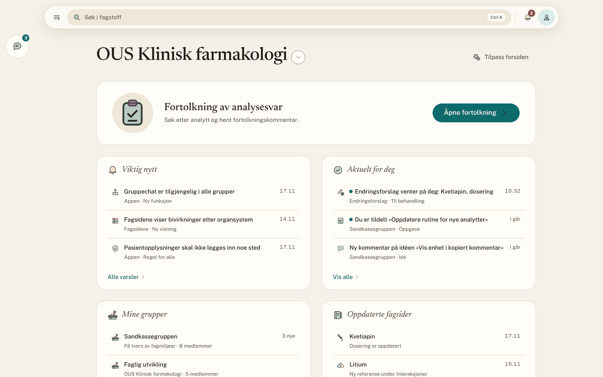
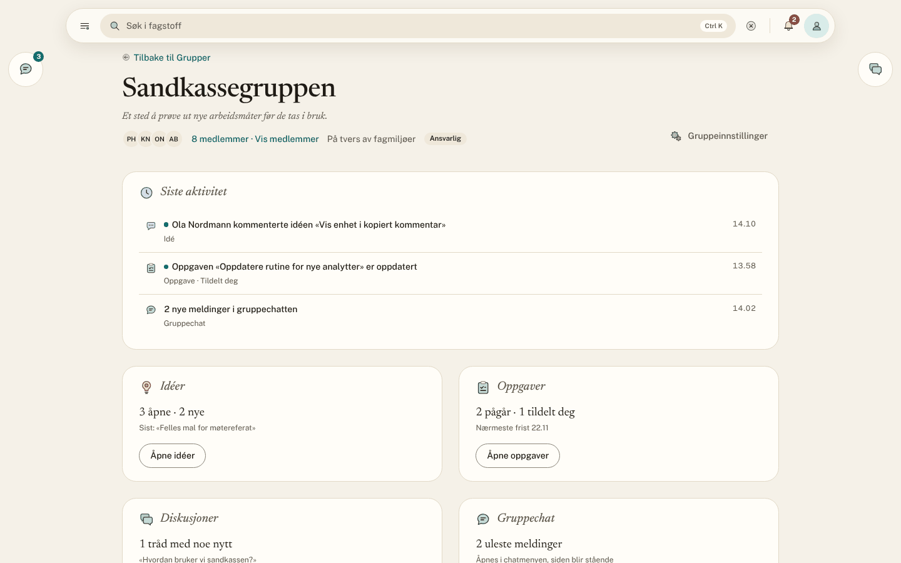
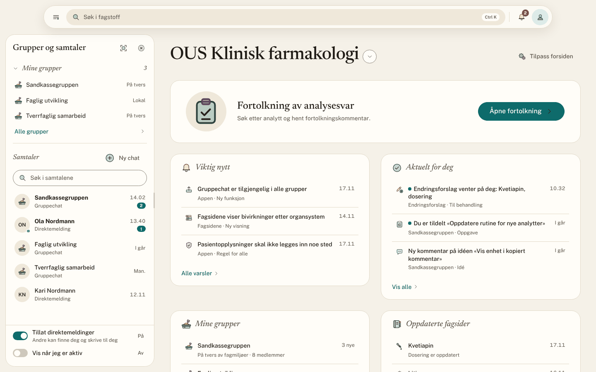
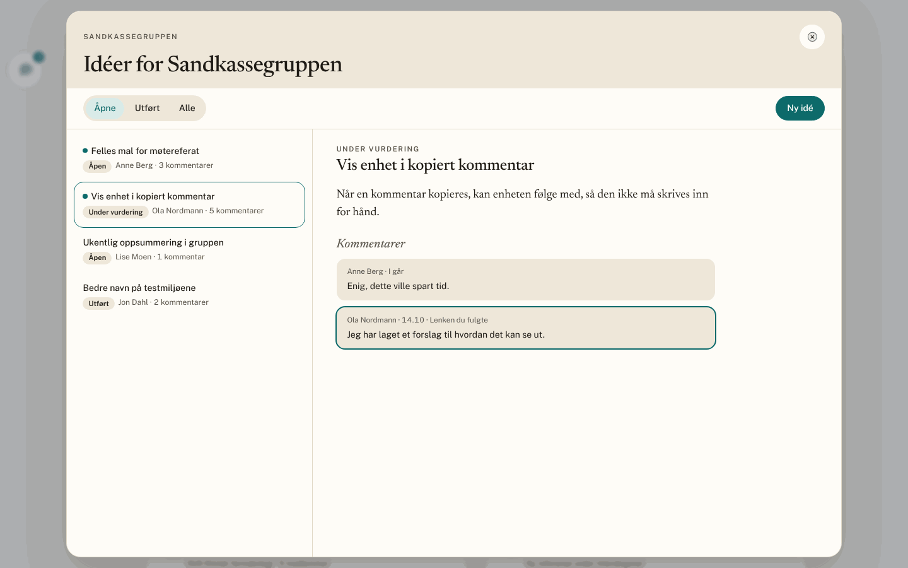
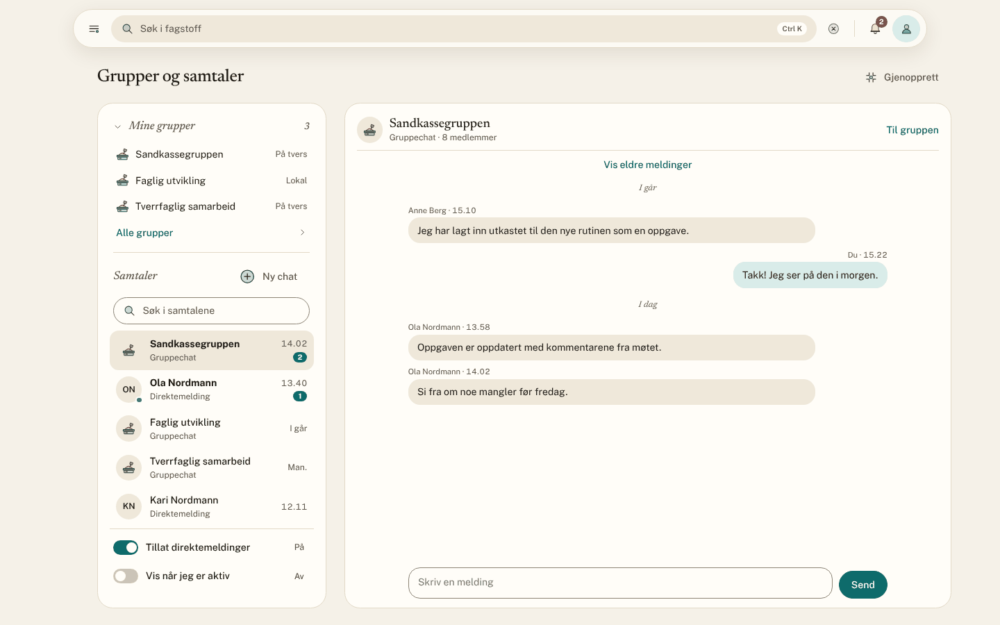
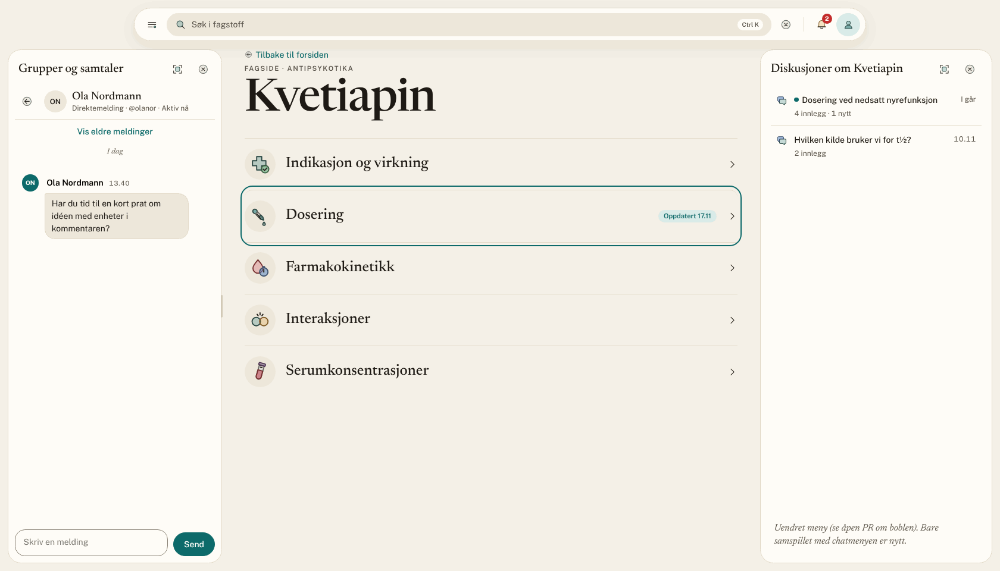

# D0: Designfasit for forside, grupper og chat

**Status:** forslag til ChatGPT-kontroll og Peders godkjenning (18.11.2026). Ingen
endring i appen eller databasen.
**Grunnlag:** [planen](../../ux-dashboard-chat-navigasjon-plan.md) (bindende),
OUSFAR Atlas ([designsystem.md](../../designsystem.md), `src/styles/tokens.css`)
og koden på `main`. Dette er konkretiseringen av planen, ikke en ny designretning.

| Fil | Innhold |
| --- | --- |
| [prototype/index.html](prototype/index.html) | Klikkbar skisse med eksempeldata. Bruker appens egne tokens og ikoner. Velg skjerm, tema og se hva neste Escape gjør i linjen nederst. Åpnes fra en lokal kopi av repoet. |
| [skisser/](skisser/) | 29 skjermbilder fra prototypen: PC, bred PC og mobil, lyst og mørkt |
| [flyt.md](flyt.md) | Sidekart, inngangsvei, lagstakk, Escape-kontrakt og chatmenyens tilstander |
| [kart.md](kart.md) | Før/etter for funksjoner som flyttes, det som ikke endres, gjenbruk og PR-rekkefølge |

## Skissene

| Planen §11 D0 | Skisser |
| --- | --- |
| 1. Rutekart, Escape, tilbake, direkte lenker, avbrutt skjema, varsler | [flyt.md](flyt.md), 06, 07, 23 |
| 2. Forside: PC og mobil, tomtilstand, 4 kort, hovedhandling, fagmiljø | 01, 02, 03, 04, 05, 24 |
| 3. Grupper, gruppedashboard, medlemmer, idé-/oppgaveflater | 08, 09, 10, 11, 12, 13, 27, 28 |
| 4. Chatmeny lukket/åpen/bred/utvidet, `#/chat`, ny melding, sperret mottaker, ulest/aktiv | 01 (boble), 14, 15, 16, 17, 18, 25, 26 |
| 5. Toppmeny, hovedmeny, kontoinnstillinger, chat og diskusjoner samtidig | 19, 20, 21, 22, 29 |
| 6. Før/etter og det som ikke endres | [kart.md §1–2](kart.md) |
| 7. Avhengigheter og parallelle PR-er | [kart.md §3–4](kart.md) |

| | | |
| --- | --- | --- |
|  01 Forside |  10 Gruppedashboard |  14 Chatmeny |
|  12 Idéer, åpnet fra en hendelse |  16 Fullsidechat |  22 Chat og diskusjoner |

## Hovedvalgene

**Forsiden (01–05, 24).** Fagmiljøets navn som sidetittel, med en rund
pilknapp når brukeren kan velge flere (04; skjult ved ett). Under den én
hovedhandling: et bredt panel med `Åpne fortolkning`, den eneste primærknappen
på siden. Deretter et luftig to-kolonnenett (`70rem` bredt, `--rom-8` mellom
panelene) med de fire standardkortene. Hvert kort har inntil tre hendelser, og
hver hendelse er én rad: ikon, hva, hvor (gruppe, fagside, appen) og når. Hele
raden er lenken til selve hendelsen; `Vis alle` er en tekstlenke, ikke en knapp.
Ulest vises med prikk og skjult tekst. Tom modul: én kursiv linje (03).
`Tilpass forsiden` (05) har én bryter og opp/ned-knapper per modul, ingen
dra-og-slipp i første versjon (enklere med tastatur og skjermleser).

**Fortolkningen (06–07).** `#/fortolkning` er dagens søk uendret, med
`Til forsiden` øverst. Escape går gjennom trinnene og stopper på søket.

**Grupper (08–13).** Invitasjoner først, så søk og en kompakt liste, arkiverte
for seg. `Opprett gruppe` åpner en modal. Gruppesiden har ingen faner:
overskrift, beskrivelse, medlemslinje (`8 medlemmer · Vis medlemmer`), `Siste
aktivitet` (3 rader som lenker) og fire korte paneler med én sekundærknapp hver.
Medlemmer og gruppeinnstillinger er modaler. Idéer og oppgaver åpnes som en stor
arbeidsflate med liste og detalj, egen adresse, og kommentaren lenken pekte på
er markert (12). Flaten ligger over siden den ble åpnet fra og lukkes dit: til
forsiden når den kom fra forsiden eller et varsel, til gruppen når den kom fra
gruppen, og til gruppen når den ble åpnet fra en lenke utenfra ([flyt.md
§2](flyt.md#2-inngangsvei-hvor-tilbake-og-lukk-går)).

**Chatmenyen (14–18, 25–26).** Boble i venstre kant, speilet av
diskusjonsboblen i høyre, med antall uleste. Åpen er den et panel i venstre kant
(`24rem`, kan dras mellom `20` og `40rem`, også med piltaster). Øverst
trekkspillet `Mine grupper` (lenker til gruppesidene), så `Samtaler`: én liste
sortert etter siste aktivitet, med søk og `Ny chat`. Nederst bryterne
`Tillat direktemeldinger` og `Vis når jeg er aktiv`. `Utvid` gir `#/chat` med
liste og samtale side om side (16), og `Gjenopprett` går tilbake til siden
brukeren var på med menyen åpen. På mobil fyller chatten skjermen. En mottaker
som har slått av direktemeldinger, gir en låst linje i stedet for skrivefeltet,
og historikken står (18, 26).

**Toppmeny, hovedmeny og konto (19–22, 29).** Toppmenyen blir
`Hovedmeny · Fagsøk · [sidens handlinger] | Varsler · Konto`: `Idéer` og
`Administrasjon` flytter inn i hovedmenyen, så fagsøket får mer plass. Hovedmenyen
får en kort navigasjonsblokk (Forsiden, Fortolkning, Grupper, Chat,
Endringsforslag; «For hele appen»: Idéer, Planlagte oppgaver, Administrasjon) over
dagens faner Stoffregister og Verktøy. Kontomenyen mister `Grupper`, og
`Preferanser` blir `Innstillinger` med fanene Visning og Chat (21).

## Valg der planen åpner for tolkning

Disse bør ChatGPT særlig vurdere:

1. **Chatinngangen.** Planen §3 nevner chat til høyre i toppmenyen, §6.1 en
   «chatboble/knapp» i venstre side. Valgt: boble i venstre kant på PC, og knapp i
   toppmenyen bare på mobil, der boblene uansett skjules. Grunner: menyen åpner
   der man klikker; den speiler diskusjonsboblen (venstre = mine samtaler, høyre
   = denne siden); og toppmenyen får ikke enda et ikon som presser søket (§3).
2. **Aktivitetsrader uten egne knapper.** Planens skisse for gruppesiden har
   `[Åpne hendelsen]` på hver rad. Valgt: hele raden er lenken, fordi §1 ber om
   ingen rader med like fremtredende knapper.
3. **Escape i chatmenyen på PC** slipper fokus i stedet for å lukke, slik
   diskusjonsmenyen gjør i dag. Menyen er et arbeidsverktøy som skal bli stående;
   den lukkes med ×. På mobil lukker Escape.
4. **Escape på fortolkningssøket** tømmer fortsatt et utfylt søkefelt, som i
   dag. Det går aldri videre til forsiden.
5. **Samme lagringsprinsipp for chatmenyen som for diskusjonsmenyen:** åpen,
   valgt samtale og bredde huskes per bruker.
6. **Nytt ikon `samtale`** (rund snakkeboble med linjer), fordi dagens
   `diskusjon`-ikon er to bobler og ville stått speilvendt rett overfor.

## Forslag til tekniske valg (planen §14)

- **Mål som tokens:** `--bredde-oversikt: 70rem` (som monografene),
  `--panelluft: var(--rom-8)`, chatmenyen `24rem` (min `20rem`, maks
  `min(40rem, 100vw - 45rem)`), `--lesebredde-minst: 45rem` for regelen om chat
  og diskusjoner samtidig, og `--chatplass` som speiler `--diskusjonsplass`.
  Prototypen har dem som `--d0-*`.
- **Forsidevalg:** én rad per bruker i en ny tabell (bruker, ordnet liste over
  `{modul, synlig}`, oppdatert), RLS bare på egen rad. Ukjente moduler i lista
  ignoreres; moduler som mangler, legges til nederst og skjult. Klienten tegner
  standardoppsettet straks og bytter når valget er hentet, uten å flytte fokus.
- **Oppsummeringene:** ett smalt kall per flate (forsiden, gruppesiden) som
  returnerer inntil tre rader per modul med id, tittel, kontekst, tid, lenkemål og
  ulest, filtrert på tilgang i databasen. Gjenbruk `mine_grupper()`,
  `gruppeoversikt()`, varseldata og endringsloggen; ingen ny hendelseslogg.
  «Oppdaterte fagsider» trenger én ny spørring på tvers av sidene (finnes ikke i
  dag), og «Nylig besøkt» utsettes til det er avklart om den krever lagring.
- **Komponentgrenser:** se [kart.md §3](kart.md#3-gjenbruk).

## Gjennomføring etter godkjenning

Fasene D1–D7 følger planen §11, i rekkefølgen i
[kart.md §4](kart.md#4-avhengigheter-og-rekkefølge). D1 (ruter, inngangsvei,
lagstakk) kommer først og alene; deretter kan forsiden, gruppene og chatmenyen
bygges parallelt. Direktemeldinger (D5) bygges ikke før personvernvurderingen
foreligger.

## Prototypen

Prototypen er en designskisse. Ingen kode derfra skal inn i appen; den bygges
med appens egne komponenter. `ikoner.js` er generert fra ikonregisteret, og
stilene bruker `src/styles/tokens.css` og `src/styles/ikon.css` direkte, så
skissen følger Atlas slik det står i koden. Alle navn og hendelser er
eksempeldata. Adressen kan styres: `index.html?skjerm=chat-apen&tema=moerkt`.
