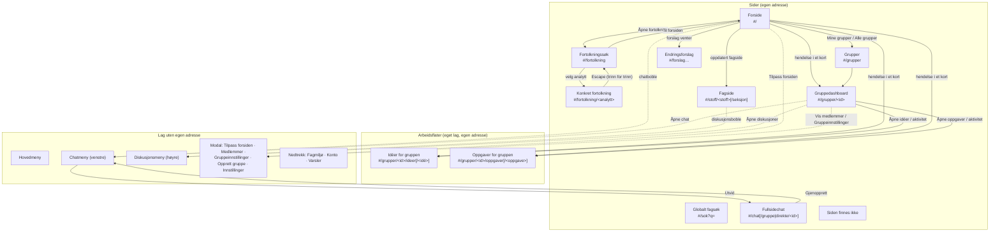
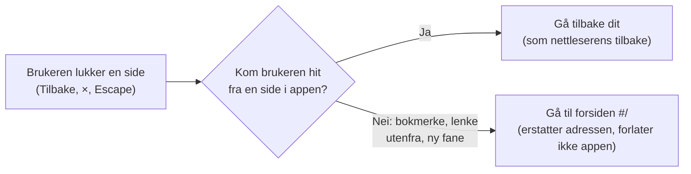
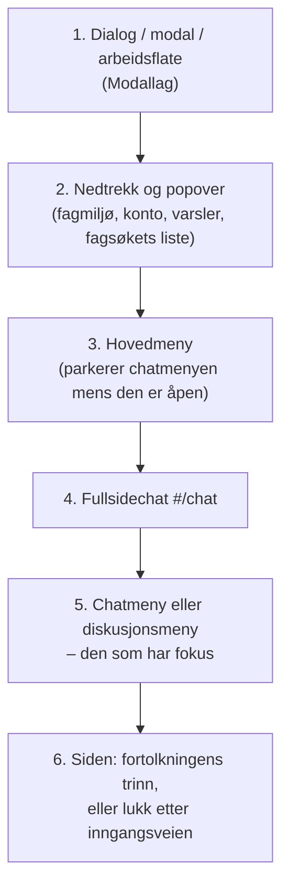
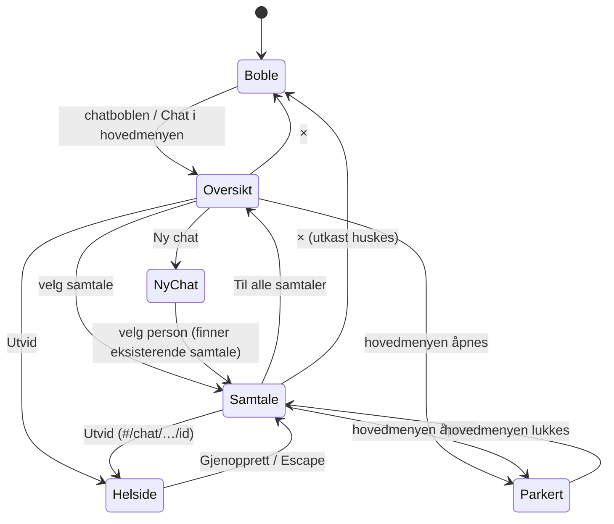

# D0: Flyt, lag og Escape

Diagrammene viser hvordan sidene, vinduene og sidemenyene i
[planen](../../ux-dashboard-chat-navigasjon-plan.md) henger sammen. Den klikkbare
[prototypen](prototype/index.html) gjør det samme i praksis: linjen nederst sier
alltid hva neste Escape gjør. Se [README](README.md) for valgene bak.

## 1. Sidekart og adresser

Hele linjer er vanlig navigering (ny adresse i nettleserhistorikken). Stiplede
linjer åpner et lag over siden uten å bytte side.

**Gamle adresser:** `#/grupper/<id>/chat` åpner gruppedashboardet med samtalen i
chatmenyen og skrives om til `#/grupper/<id>` (konteksten beholdes; `Utvid`
gir `#/chat/gruppe/<id>`). `#/analytt/<kode>`, `#/diskusjon/<id>[/<kommentar>]` og
`#/ide/<id>[/<kommentar>]` virker som i dag. Ukjent eller utilgjengelig adresse gir
«Siden finnes ikke» med `Til forsiden` (skisse 23), aldri fortolkningssøket, og sier
ikke om noe skjult finnes.

## 2. Inngangsvei: hvor «Tilbake» og «Lukk» går

Appen husker adressene brukeren kom fra *inne i appen*. Lenken over
sideoverskriften sier hvor den går («Tilbake til Grupper»), og lukkeknappen i
toppmenyen gjør det samme.

- Nettleserens tilbake- og framknapp virker som før, også mellom forside, søk,
  fortolkning, fagside, grupper og chat.
- `Til forsiden` (fortolkningssøket) og `Åpne fortolkning` (forsiden og
  hovedmenyen) er egne, faste handlinger, uavhengig av inngangsveien.
- Et varsel i bjella eller en hendelse på forsiden åpner selve hendelsen
  (riktig idé, oppgave, kommentar eller samtale). Lukking går tilbake dit varselet
  ble åpnet fra (planen §12).
- En arbeidsflate (idéer, oppgaver i en gruppe) følger den samme regelen. Den
  legger seg over siden den ble åpnet fra, og lukking viser den siden igjen:

  | Åpnet fra | Tilbake, ×, Escape og nettleserens tilbake går til |
  | --- | --- |
  | Forsiden, et varsel i bjella, chatten eller en annen side i appen | Den siden (skisse 12: idéen er åpnet fra forsiden) |
  | Gruppesiden | Gruppesiden (skisse 13) |
  | Lenke utenfra, bokmerke, ny fane | Gruppesiden flaten hører til, som erstatter adressen. Gruppen er reserven her, ikke forsiden, fordi det er der idéen eller oppgaven hører hjemme. |

  Å velge en annen idé eller oppgave i lista inne i flaten bytter adressen uten å
  lage en ny oppføring i historikken. Derfor går både lukking og nettleserens
  tilbakeknapp ut av flaten i ett steg, uansett hvor mange elementer brukeren
  har sett på.
- **Avbrutt skjema:** alle lukkeveier (Tilbake, ×, Escape, nettleserens tilbake,
  `Gjenopprett`) går gjennom dagens skjemavakt (`useForlatvakt` / `Modallag`
  `vedLukking`). Ulagret tekst gir dagens bekreftelse, og et chatutkast blir
  liggende til samtalen åpnes igjen i samme økt.

## 3. Lagstakken

Ett lag eier Escape om gangen: det øverste. Rekkefølgen ovenfra:

**Chatmeny og diskusjonsmeny samtidig.** Begge kan stå åpne på bred PC når
siden mellom dem fortsatt er minst `45rem` bred (skisse 22). Ellers vinner den
som ble åpnet sist, og den andre blir til boblen sin igjen med tilstanden bevart.
På mobil fyller hver av dem skjermen, og bare én er åpen.

**Hovedmenyen** har forrang over chatmenyen: den åpnes over, chatmenyen
parkeres (skjules, men beholder samtale, utkast og bredde) og kommer tilbake når
hovedmenyen lukkes (skisse 19). Ingen dobbel mørklegging.

## 4. Escape-kontrakten

| Øverste lag eller side | Escape gjør | Neste Escape |
| --- | --- | --- |
| Modal | Lukker bare den (med skjemavakt) | Neste lag under |
| Arbeidsflate (idéer, oppgaver) | Lukker den etter inngangsveien (§2), med skjemavakt | Siden den ble åpnet fra |
| Nedtrekk / popover | Lukker den, fokus til knappen | Neste lag under |
| Hovedmeny | Lukker den, henter chatmenyen tilbake | Siden |
| Fullsidechat (PC) | `Gjenopprett`: forrige side med chatmenyen åpen på samme samtale, fokus i menyen | Slipper chatmenyen |
| Chatmeny med fokus (PC) | Slipper fokus til siden; menyen blir stående (som diskusjonsmenyen i dag) | Siden |
| Chat på mobil | Lukker chatten; samtale og utkast huskes | Siden |
| Diskusjonsmeny med fokus | Som i dag (helside → panel; ellers slipp) | Siden |
| Konkret fortolkning | Ett trinn tilbake i fortolkningen (uendret) | … til søket |
| Fortolkningssøket | Tømmer søkefeltet som i dag; **ellers ingenting** | Ingenting |
| Forsiden | Ingenting | Ingenting |
| Andre sider (fagside, grupper, gruppe, søk, forslag) | Lukker etter inngangsveien (§2) | … |

Krav til D1 (planen §5.2): én sentral lagstakk erstatter de spredte
`keydown`-lytterne. Hvert lag melder seg på og av; bare det øverste får
tastetrykket, og det stoppes der (`preventDefault`). `useKeyboard` og
`useLukkMedEscape` spør stakken i stedet for `[data-lag]`/`dialog[open]`.
Kartleggingen fant tre steder der samme Escape i dag kan treffe to lag:
`Sidemeny` og `Nedtrekksmeny` sjekker ikke om en dialog ligger over dem, og
`useKeyboard` ser ikke på `defaultPrevented`. Testene skal dekke nettopp disse.

## 5. Chatmenyens tilstander

- Valgt samtale, utkast, bredde og åpen/lukket huskes i økten (`useBevart`),
  som diskusjonsmenyen.
- Å åpne menyen merker ingenting lest. En samtale merkes lest først når den
  vises, vinduet er synlig og brukeren har nådd de siste meldingene (som
  gruppechatten i dag).
- Panelet og helsiden er to visninger av den samme samtalen og den samme
  meldingstilstanden (`useGruppechat`), ikke to kopier.
