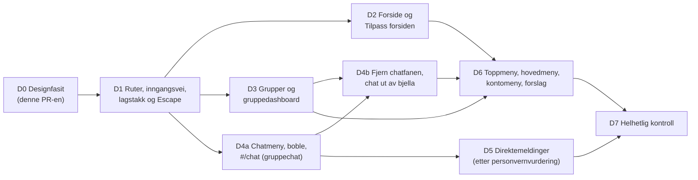

# D0: Før og etter, det som ikke endres, og avhengigheter

Kartet bygger på en gjennomgang av koden på `main` 18.11.2026. Se
[README](README.md) for valgene og [flyt.md](flyt.md) for lag og Escape.

## 1. Funksjoner som flyttes

| Funksjon | I dag | Etter omleggingen | Fase |
| --- | --- | --- | --- |
| Startsiden `#/` | Fortolkningssøket (`App.tsx`, alltid montert) | Personlig forside; søket flytter til `#/fortolkning` | D1–D2 |
| Lukking av sider | `lukkInfoside` sender alltid til fortolkningen | Inngangsveien, med forsiden som reserve ([flyt.md §2](flyt.md#2-inngangsvei-hvor-tilbake-og-lukk-går)) | D1 |
| Escape på en side | `useLukkMedEscape` → fortolkningen | Samme vei som Tilbake; stopper på `#/fortolkning` | D1 |
| Idéer for appen og Planlagte oppgaver | `Ideknapp` i toppmenyen | Hovedmenyen, «For hele appen» | D6 |
| Administrasjon | `Adminmeny` i toppmenyen | Hovedmenyen, rollestyrt (samme modaler) | D6 |
| Grupper-snarvei | Kontomenyen, med prikk for invitasjon | Hovedmenyen og chatmenyen; invitasjonen øverst på `#/grupper` og telles i hovedmenyen | D3/D6 |
| Bytte fagmiljø | `Arbeidsfagmiljovalg` i kontomenyen | Også pilen ved fagmiljønavnet på forsiden; samme komponentlogikk, kontomenyen beholder valget | D2 |
| Preferanser | Skuff i kontomenyen | «Innstillinger» i kontomenyen: vindu med fanene Visning og Chat; innholdet i Visning er uendret | D5/D6 |
| Ny gruppe | Innlinjeskjema nederst i gruppeoversikten | Modal fra `Opprett gruppe` | D3 |
| Gruppefaner | `Oversikt / Idéer / Oppgaver / Chat / Diskusjoner` | Ingen faner; gruppedashboard med fire korte paneler | D3 |
| Gruppeadministrasjon | Knapper og medlemsliste i Oversikt-fanen | `Gruppeinnstillinger` (navn, arkiver, forlat) og `Medlemmer` (inviter, rolle, fjern) som modaler | D3 |
| Gruppeidéer og -oppgaver | Innebygd i fanen | Stor arbeidsflate med samme adresse og direkte lenke; lukkes dit den ble åpnet fra ([flyt.md §2](flyt.md#2-inngangsvei-hvor-tilbake-og-lukk-går)) | D3 |
| Gruppechat | Fane på gruppesiden | Chatmenyen i venstre kant og `#/chat` | D4 |
| Uleste chatmeldinger | Varselbjella (kategorien `gruppechat`) | Chatboblen og samtalelisten; bjella teller dem ikke lenger | D4 |
| Diskusjonsmenyen | Høyre kant, alene | Høyre kant, deler bredden med chatmenyen etter regelen i [flyt.md §3](flyt.md#3-lagstakken) | D4 |

## 2. Dette endres ikke

- Fortolkningens trinn, taster, automatisk kopiering, terskler, regler og
  kommentartekster. Escape i en konkret fortolkning går gjennom de samme trinnene
  som i dag (`stepBack`), og testene `fortolkningUendret` og `thcMotor` er vakten.
- Fagsidenes faginnhold, seksjoner, detaljkort, kilder og redigering.
- Verktøyene i verktøymenyen og innholdet deres (OUSFAR Verktøy).
- Stoffregisteret og fanene Stoffregister/Verktøy i hovedmenyen, med favoritter
  og kategorier.
- Fagsøket (`Ctrl/Cmd+K`), søk på siden (`Ctrl/Cmd+B`), hovedmenyen (`Ctrl+M`),
  metodefilteret (`Alt+tall`), dokken på mobil og toppmenyens trinn fra hel til
  kompakt til dokk.
- Diskusjonsmenyens innhold, helside, bredde, fokus og direkte lenker (åpen PR
  #459 om boblen er uavhengig av dette).
- Gruppechattens funksjoner og utseende: snakkebobler med profilbilde og navn,
  egne meldinger til høyre (PR #455), grupperte meldinger, datooverskrifter,
  Enter/Shift+Enter, eldre meldinger, rulleposisjon, utkast, redigering, sletting,
  moderering, lesere og 12 måneders lagringstid.
- Tilgangene: grupper, fagmiljøer, roller, systemarkitektens «Ikke medlem».
- Direkte lenker: `#/stoff/…`, `#/fortolkning/…`, `#/analytt/…`, `#/diskusjon/…`,
  `#/ide/…`, `#/forslag/…`, `#/grupper/…`.
- Varselbjellas kategorier, valg og 30 dagers frist, bortsett fra at chat ikke
  lenger vises der.
- Atlas: tokens, ikoner, Modallag, paneler, knapper og tema. Ingen ny
  designretning.

## 3. Gjenbruk

| Behov | Gjenbrukes | Nytt eller endret |
| --- | --- | --- |
| Paneler på forsiden og gruppesiden | Atlas-panel (`--runding-panel`, kursiv seriftittel med ikon), `Panelhode`, `Merke` | Liten felles `Oppsummeringskort` med hendelsesrad (ikon, hva, hvor, når, lenke), maks 3 |
| Fagmiljøvalg | `Arbeidsfagmiljovalg`, `useRettigheter`, `velgArbeidsfagmiljo` | Popover-visning av samme valg |
| Tilpass forsiden | `Modallag`, `Bryter`, `Ikonknapp` (opp/ned) | Lagring per bruker (D2) |
| Modaler og arbeidsflater | `Modallag` (`bred`, `fot`, `vedLukking`), `useForlatvakt`, `useMeldVakt` | Størrelse «arbeidsflate» (inntil 82rem, full høyde) |
| Idéer og oppgaver | `Ideliste`/`Idekort`, `Ideside`, `Ideskjema`, `Oppgaveliste`, `Oppgaveside`, `Merker` | Delt liste/detalj-oppsett |
| Gruppedata | `useMineGrupper`, `Gruppesamhandling` (`nye_ideer`, `venter`, `mine_oppgaver`, `chat_uleste`) | Oppsummering av siste aktivitet (D3) |
| Chat | `useGruppechat`, `Gruppechat`, `Gruppechatmelding`, `Gruppechatskriving`, `gruppechatvisning.ts` | Chatmeny, samtaleliste, `#/chat` |
| Menyboble og bredde | Mønsteret fra `Diskusjonsmeny` (boble, `--diskusjonsplass`), `Kanthandtak` + `useDrattLengde`, `useBevart` | `--chatplass` langs venstre kant |
| Fullside | `useRestenInert` | Egen adresse `#/chat` |
| Hovedmeny | `Sidemeny` med fokusfelle og `Ctrl+M` | Navigasjonsblokk over fanene |
| Varsler | `Varselknapp`, `VARSELKATEGORIER`, `endringsvarsler` | `gruppechat` ut av bjellas visning og sum |
| Ikoner | Registeret i `src/components/ikon/register.ts` | Nytt ikon `samtale` (rund snakkeboble), så chat ikke forveksles med `diskusjon` |

## 4. Avhengigheter og rekkefølge

**Trygt parallelt etter D1:** D2, D3 og D4a rører hver sine filer
(`src/components/forside/`, `src/components/grupper/`, `src/components/chat/`).
Felles berøringspunkter avtales i D1 og endres ikke av dem: rutetypene i
`src/domain/rute.ts`, lagstakken og plassvariablene `--chatplass` og
`--diskusjonsplass`.

**Må i rekkefølge:**

1. D1 først; den bytter hva `#/` er og må ha regresjonstester for alle gamle
   adresser før noe annet bygger på den.
2. Chatfanen fjernes (D4b) først når chatmenyen (D4a) og gruppedashboardet
   (D3) er slått sammen, så ingen funksjon forsvinner underveis.
3. Chat ut av bjella (D4b) i samme PR som chatboblen får tallet, så uleste
   aldri telles to steder eller ingen steder.
4. D5 aktiveres ikke før personvernvurderingen og eventuelt Peders ja finnes
   (planen §6.3). Brytere og visninger i skissene er bare utseendet.
5. D6 sist av UI-delene, fordi den flytter inngangene (Idéer, Admin, Grupper)
   som D2–D4 trenger mens de testes.

**Åpne PR-er:** #459 (diskusjonsboblen vokser uten linjeskift) endrer bare
boblens tekst og bredde og overlapper ikke. D4a gjenbruker boblemønsteret slik
det står etter #459.
