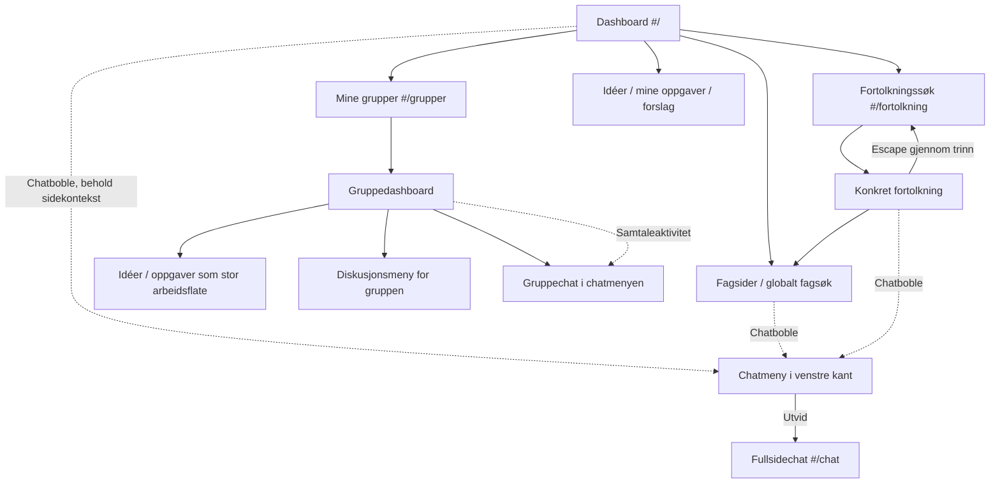

# Plan: Dashboard, navigasjon, grupper, chat og felles UX i OUSFAR

**Dato:** 18.11.2026  
**Status:** Konkret produkt- og implementeringsspesifikasjon. **Første leveranse er design og brukerflyt, ikke kode.** Videre implementering avventes til skisser og flytdiagram er gjennomgått av ChatGPT og hovedutformingen godkjent av Peder.  
**Eier:** OUSFAR Dev (`ansvar:dev`).  
**Omfang:** Appens felles grensesnitt, navigasjon, dashboards, grupper, varsler, chat og tilhørende tilgangsmodell. Ikke fagsidenes faginnhold (OUSFAR Fag) eller verktøyene i Verktøy-menyen (OUSFAR Verktøy).

Dette dokumentet fastsetter *hva* som skal bygges, hvilke eksisterende løsninger som skal gjenbrukes og hva som ikke skal endres. Det supplerer `docs/ux-reimagination.md` og designsystemet OUSFAR Atlas (`docs/designsystem.md`); det innfører **ikke** et nytt designsystem. Gjeldende `AGENTS.md` og `docs/prosjektansvar.md` gjelder ved all videre utførelse.

## 1. Produktmål og avgrensning

Forsiden skal være et rolig, personlig dashboard: brukeren ser hvilket fagmiljø som er aktivt, kommer til fortolkningssøket med ett tydelig klikk og får en liten oversikt over de få tingene som er viktige for vedkommende. Grupper skal være oversiktlige samarbeidsrom, ikke sider med fem konkurrerende faner. Kommunikasjon skjer i en felles chatflate; diskusjoner om konkrete fagsider/fortolkninger beholder sin egen kontekstuelle sidemeny.

Tre forskjellige oppgaver gir tre forskjellige flater:

1. **Oversiktsside/dashboard:** kort, prioritert informasjon og veier videre; aldri hele arbeidslisten.
2. **Arbeidsflate:** selve fortolkningen, stor idé-/oppgavevisning, behandling av endringsforslag, detaljert administrasjon.
3. **Kontekstuell sidemeny:** chat og diskusjoner, tilgjengelig uten å forlate det man arbeider med; kan utvides ved behov.

Felles regler:

- Store, luftige, tydelig innrammede paneler. Vanlige PC-bredder: romslig ytre marg, gjennomgående 24–32 px mellom hovedpaneler, få elementer per panel. Eksakte mål tilpasses Atlas-tokens og tilgjengelig skjermbredde, ikke tilfeldige lokale CSS-tall.
- Én tydelig hovedhandling per skjerm. Sekundære handlinger underordnes visuelt; ingen gjentatte rader med like fremtredende knapper.
- Maksimalt 2–3 synlige oppføringer per oppsummeringspanel, med `Vis alle` eller tilsvarende.
- Relevans foran aktivitet: ingen ubegrenset nyhetsstrøm, blinkende varsler, automatisk omflytting av paneler eller store tallfelt uten oppgave.
- Brukeren skal forstå **hvor** en aktivitet hører hjemme (app, fagmiljø, gruppe, konkret fagside, samtale), og lenken skal gå til **selve hendelsen**.
- Mørkt/lyst tema, redusert bevegelse, skjermleser, tastatur og mobil er fullverdige varianter av samme løsning.
- Ikke legg inn påminnelser om pasientopplysninger i skrivefeltene: beslutningen i `docs/pasientopplysninger.md` gjelder uendret. Forbudet mot pasientopplysninger gjelder likevel overalt.

### Ikke del av denne omleggingen

- Kliniske terskler, analyseregler, utregninger, kommentartekst eller innarbeidede taster i fortolkningsflyten.
- Faglig tekst på monografiene; eksisterende sammenleggbare fagseksjoner skal beholdes.
- Funksjonalitet *inne i* kliniske verktøy i Verktøy-menyen.
- Generell ny sosial aktivitetsstrøm eller offentlig katalog over alle brukeres oppførsel.
- Filvedlegg i chat, e-post/push eller eksport av chat. Dette krever særskilt vurdering.

## 2. Informasjonsarkitektur og adresser

| Adresse | Flate | Forventet funksjon |
| --- | --- | --- |
| `#/` | Personlig dashboard | Ny startside etter innlogging; ikke fortolkningssøket |
| `#/fortolkning` | Fortolkningssøket | Egen fullverdig side; stort og raskt søk |
| `#/fortolkning/<analytt>` | Konkret fortolkning | Dagens direkte lenker videreføres |
| `#/stoff/<stoff>` | Fagside | Uendret faglig oppbygging og direkte lenker |
| `#/sok?q=...` | Globalt fagsøk | Eget domene, ikke fortolkningssøket |
| `#/stoffregister` | Stoffregister | Full oversikt og separat redigering |
| `#/grupper` | Mine grupper | Kompakt helsideoversikt, invitasjoner og opprett-knapp |
| `#/grupper/<gruppe-id>` | Gruppedashboard | Én oversikt, ikke en hovedfanerad |
| `#/grupper/<gruppe-id>/ideer` | Gruppeidéer | Stor idéarbeidsflate/modalt lag over gruppen |
| `#/grupper/<gruppe-id>/ideer/<ide-id>` | Konkret gruppeidé | Åpner riktig idé og kommentar-/aktivitetspunkt |
| `#/grupper/<gruppe-id>/oppgaver` | Gruppeoppgaver | Stor oppgavearbeidsflate/modalt lag |
| `#/grupper/<gruppe-id>/oppgaver/<oppgave-id>` | Konkret oppgave | Åpner oppgaven direkte |
| `#/chat` | Fullsidechat | Samtaleoversikt og aktiv samtale i helside |
| `#/chat/gruppe/<gruppe-id>` | Gruppechat i helside | Stabil, delbar vei til gruppechatten |
| `#/chat/direkte/<samtale-id>` | Direktechat i helside | Kun deltakere kan lese; ingen bruker-ID-basert gjetting |
| `#/forslag` / `#/forslag/til-behandling` / `#/forslag/<id>` | Endringsforslag | Eksisterende adresser beholdes |
| `#/diskusjon/<id>` / `#/ide/<id>` | Direktelenker | Eksisterende oppslag og fremheving beholdes |

**Eksisterende adresser skal ikke slutte å virke.** Gamle `#/grupper/<id>/chat` skal lede til riktig gruppechat (sidemodus eller fullside, med kanonisk chatadresse), og de gamle gruppeidé-/oppgaveadressene skal fremdeles åpne målet. Eldre `#/analytt/<kode>`, lenker til fortolkning og kort på fagsider må fortsatt kunne åpnes. Ukjente/ugyldige adresser skal gi en forståelig feil eller gå til dashboard, **ikke** umerkelig tolkes som fortolkningssøket.

### Skisse av hovedflyt



## 3. Globalt appskall og toppmeny

OUSFAR Atlas skal fortsatt styre toppraden. Unngå en ny ikonrekke som gjør hovedsøk og kliniske handlinger trange.

**PC:** Fra venstre: hovedmeny, globalt fagsøk, eventuelle kontekstuelle sidehandlinger; til høyre et tydelig chatinngangspunkt, varselbjelle og konto. Fortolkning skal alltid nås med én handling (snarvei i hovedmeny/toppmeny og stor knapp på dashboard). Flytt mindre brukte globale innganger, som Idéer og administrasjon, til hovedmenyen og/eller rollebetingede snarveier på dashboardet. Om de blir i toppmenyen, må det begrunnes i designskissene uten at søket fortrenges.

**Mobil:** Eksisterende dynamiske toppmeny og dokk videreføres; viktigste søk og sidens hovedhandling har prioritet. Chat og hovedmeny kan åpnes i fullskjerm. Ingen to smale sidepaneler ved siden av innholdet.

**Menylag:** Hovedmenyen har høyest prioritet av sidemenyene. Åpning av hovedmenyen parkerer/lukker midlertidig chatmenyen, i stedet for å la to menyer dekke hverandre; tidligere chat-/samtaletilstand gjenopptas når brukeren åpner chat igjen. På bred PC kan diskusjoner og chat sameksistere bare når arbeidsflaten fortsatt har forsvarlig lesebredde; ellers byttes synlig panel. Et dialogvindu ligger alltid foran sidemenyer.

**Fokus og Escape:** Ett sentralt prinsipp for lagstakken (dialog > aktivt fullskjerm-/sidepanel > sideinnhold). Bare øverste relevante lag håndterer Escape. Lukking returnerer fokus til åpneknappen eller logisk forrige kontroll. Tastetrykket må ikke sendes videre til fortolkningen bak.

## 4. Personlig dashboard: detaljert innhold

### 4.1 Overordnet oppsett (stor PC)

```text
┌──────────────────────────────────────────────────────────────────────────┐
│ [Hovedmeny]  [Søk i fagstoff …………………]      [Chat] [Varsler] [Konto] │
├──────────────────────────────────────────────────────────────────────────┤
│                                                                          │
│  OUS Klinisk farmakologi  ▾                         [Tilpass forsiden] │
│  (navnet på aktivt arbeidsfagmiljø; valg for flerfagmiljøbrukere)         │
│                                                                          │
│  ┌───────────────────────────────────────────────────────────────────┐  │
│  │ FORTOLKNING AV ANALYSESVAR                                       │  │
│  │ Søk etter analytt og hent fortolkningskommentar                  │  │
│  │ [       Åpne fortolkning  →       ]  (stor, primær knapp)         │  │
│  └───────────────────────────────────────────────────────────────────┘  │
│                                                                          │
│  ┌───────────────────────┐    ┌──────────────────────────────────────┐  │
│  │ VIKTIG NYTT           │    │ AKTUELT FOR DEG                      │  │
│  │ 2–3 oppføringer       │    │ 2–3 prioriterte hendelser            │  │
│  │ Vis alle →            │    │ Vis alle →                           │  │
│  └───────────────────────┘    └──────────────────────────────────────┘  │
│                                                                          │
│  ┌───────────────────────┐    ┌──────────────────────────────────────┐  │
│  │ MINE GRUPPER          │    │ OPPDATERTE FAGSIDER                  │  │
│  │ 2–3 grupper          │    │ 2–3 nylige publiseringer            │  │
│  │ Alle grupper →        │    │ Vis flere →                          │  │
│  └───────────────────────┘    └──────────────────────────────────────┘  │
└──────────────────────────────────────────────────────────────────────────┘
```

Skissen viser rekkefølge og informasjonsmengde, **ikke eksakte stiler**. På PC bør hovedinnholdet ha en kontrollert maksimalbredde og et luftig to-kolonnenett; panelene trenger ikke være like høye. På nettbrett og mobil én kolonne. Hero-panelet med fortolkning er en permanent snarvei (ikke en kopi av hele søkegrensesnittet).

### 4.2 Standardmoduler, innhold og grenser

| Modul | Standard | Maks synlig | Innhold og interaksjon |
| --- | --- | --- | --- |
| **Fortolkning** | Fast hovedhandling | 1 knapp | `Åpne fortolkning` → `#/fortolkning`. Skal fungere straks, uavhengig av øvrige panelers lasting. |
| **Viktig nytt** | På | 3 | Viktige funksjonsmeldinger/faglige kunngjøringer fra appens eksisterende varsel-/endringssystem. Bare overskrift, kort kontekst og dato. Ikke full varselhistorikk. |
| **Aktuelt for deg** | På | 3 | Oppgaver, forslag, invitasjoner og diskusjonsaktivitet som **krever eller fortjener oppfølging**; prioritert etter handlingsbehov og deretter tid. |
| **Mine grupper** | På | 3 | Relevante grupper brukeren er med i; gruppenavn, kort tilhørighet og snarvei. Vurder ny aktivitet som diskret indikator, ikke stor tallblokk. |
| **Oppdaterte fagsider** | På | 3 | Siste publiserte endringer (ikke lagrede utkast), med stoffnavn, kort hva som ble endret og lenke til riktig seksjon. |
| **Nytt i idébanken** | Av | 3 | Nye idéer i appen og grupper brukeren kan lese, merket `Appen`/gruppenavn. |
| **Mine oppgaver** | Av | 3 | Egen oppgavetildeling i grupper; systemarkitekter kan i tillegg se relevante planlagte appoppgaver med tydelig kontekstskille. |
| **Diskusjoner jeg følger** | Av | 3 | Nye innlegg i egne/fulgte tråder med lenke til riktig innlegg og meny. |
| **Favorittfagsider** | Av | 3 | Snarveier til favoritter og evt. markering av publiserte endringer; ikke parallell vedlikeholdsliste. |
| **Nylig besøkt** | Av | 3 | Nylige fagsider/andre sider i brukerens egen kontekst, uten sensitive arbeidsdata og uten langvarig sporingslogg. Kan utsettes hvis datagrunnlaget krever ny lagring. |

Hvis en valgfri modul har null relevante oppføringer, skal den ikke vise en stor tom liste. Bruk et diskret `Ingen nye hendelser` eller skjul den tomme innholdslisten; modulens overskrift og eventuell handling kan beholdes. Dashbordet skal aldri vise falske demooppføringer i produksjon.

### 4.3 Prioritering og ingen dobbel varsling

`Viktig nytt` viser kunngjøringer som angår appen; `Aktuelt for deg` viser personlige handlinger. Fagsideoppdateringer har eget panel; grupper og chat har egne arbeidsflater. Ikke vis samme hendelse i flere kort som om den var flere saker. Gjenbruk stabil hendelses-ID og lest-/ulestmodell der den finnes. Et kritisk faglig varsel skal alltid kunne nås i varselbjella selv når `Viktig nytt` er skjult.

### 4.4 Tilpass forsiden

`Tilpass forsiden` åpner én ryddig modal: av/på for hver valgfri modul, rekkefølge opp/ned eller tilgjengelig dra-og-slipp, `Gjenopprett standard`. Den permanente fortolkningshandlingen kan ikke skjules. Ingen fritt flytende widgets, vilkårlige størrelser eller komplekst rutenett i første versjon.

- Lagres per innlogget bruker i databasen, med tilgang bare til egen preferanse. Den følger brukeren mellom maskiner og oppdateringer.
- **Én layout per bruker på tvers av fagmiljøer**, mens selve innholdet filtreres etter aktivt fagmiljø og personlige medlemskap. Ikke separate layouts per laboratorium i første versjon.
- Når nye moduler introduseres, skal eksisterende egne valg beholdes. Nye moduler slås av som standard med mindre det er en eksplisitt viktig grunn.
- Innstillingene bør ikke gjøre appen langsommere å åpne: render fornuftig standard først, oppdater layout når brukerpreferansen er klar uten å flytte fokus.

### 4.5 Fagmiljøoverskrift og bytte

Overskriften er **navnet på gjeldende arbeidsfagmiljø**, for eksempel `OUS Klinisk farmakologi`. En diskret pil åpner popover med fagmiljøer brukeren har tilgang til. Med bare ett mulig valg er pilen skjult. Et bytte oppdaterer navn og fortolkningsgrunnlag atomisk; gamle lokale data skal ikke bli liggende synlig mens nye data hentes.

Gjenbruk `Arbeidsfagmiljovalg` og `useRettigheter`; ikke lag et nytt parallelt valg. Systemarkitekt kan allerede velge fagmiljø hen ikke er medlem av; merk i så fall `Ikke medlem`, og **ikke** la valget alene gi medlemsrettigheter. Fagsidene er felles, fortolkningen lokal; grupper og direktekommunikasjon følger brukerens faktiske tilganger på tvers av arbeidsfagmiljøet. Vis gruppetilhørighet når det trengs for å unngå sammenblanding.

## 5. Fortolkning, Escape, lukking og navigasjon

### 5.1 Avgjørende endring

I dag er `#/` fortolkningen, og fagsider, gruppevisninger m.m. lukkes generelt tilbake til den. Nå skal `#/` være dashboard. Felles `lukkInfoside` i `src/App.tsx` kan derfor ikke lenger blindt sende alt tilbake til fortolkning.

Innfør en sentral, eksplisitt modell for **hvor brukeren kom fra**, basert på intern navigasjon og nettleserhistorikk, med trygg fallback til `#/` når en side åpnes direkte fra bokmerke. Ikke bruk `history.back()` ukritisk hvis den kan sende brukeren ut av appen. Bevar normal tilbake-/framknapp. Et klikk på `Til forsiden` og `Til fortolkningen` er tydelige, separate handlinger.

### 5.2 Escape-kontrakt

1. Åpen modal/redigering eller overliggende meny: Escape lukker/avbryter bare **øverste** element; ulagrede endringer krever eksisterende bekreftelse.
2. I en konkret fortolkning: Escape går bakover gjennom fortolkningens **egne** trinn, og etter nok trykk ender brukeren på `#/fortolkning`.
3. På `#/fortolkning`: ytterligere Escape **gjør ingenting**. Aldri send brukeren utilsiktet til dashboard.
4. Fra fortolkningssøket finnes synlig `Til forsiden`-knapp. Nettleserens vanlige tilbakeknapp fungerer likevel.
5. Når chatmenyen er fokusert og maksimeres: første Escape gjenoppretter sidemenyen, neste Escape følger menyens lukkekontrakt; **ikke** aktiver underliggende fortolkning.
6. På fagsider, globalt søk, grupper og administrative flater: synlig tilbake/avslutt følger faktisk inngangsvei, med dashboard som fallback ved direkte inngang. Escape skal ikke slette eller resette arbeid.

Gå gjennom `src/hooks/useKeyboard.ts`, `useLukkMedEscape.ts`, `useRute.ts`, `src/domain/rute.ts`, `src/App.tsx`, `src/components/Sidemeny.tsx`, `src/components/Modallag.tsx` og `src/components/diskusjoner/Diskusjonsmeny.tsx` samlet. Tester skal sikre at samme Escape aldri behandles av to lag.

### 5.3 Direkte lenker og bevart kontekst

- Eksisterende `#/diskusjon/<id>` og `#/ide/<id>` med kommentarlenker skal fortsatt åpne riktig tråd/idé og markere konkret kommentar.
- Lenker fra dashboard og gruppeaktivitet skal lande på hendelsen, ikke bare første oversiktsside.
- Gruppens idé-/oppgavevisninger skal kunne vises som modal/arbeidsflate **uten å miste adressens identitet**.
- En fullsidechat og en chatmeny skal være to visninger av samme samtale, ikke to ulike datatilstander. Brukeren kan forlate helsiden og komme tilbake til kontekstsiden.
- Dyp lenke uten tilgang skal oppføre seg som ukjent/ikke tilgjengelig; ikke røp at en skjult gruppe, samtale eller bruker finnes.

## 6. Chatmeny, fullsidechat og direktemeldinger

### 6.1 Plassering og oppsett

Ny inngang ved venstre side av appen (chatboble/knapp). Når den åpnes vises:

```text
┌─────────────────────────────────────┐
│ Grupper og samtaler         [⇱] [×] │
│                                     │
│ ▾ Mine grupper                   3  │
│   Sandkassegruppen                 │
│   Faglig utvikling                  │
│   Tverrfaglig samarbeid             │
│   Alle grupper →                    │
│ ─────────────────────────────────── │
│ Samtaler                 [Ny chat +]│
│ [Søk i samtalene ……………………]           │
│ ● Sandkassegruppen   Gruppechat      │
│   Ola Nordmann       Direktemelding  │
│   Faglig utvikling   Gruppechat      │
│                                     │
│ [Tillat direktemeldinger: Av / På]   │
│ [Vis når jeg er aktiv: Av / På]      │
└─────────────────────────────────────┘
```

- `Mine grupper` er trekkspillseksjon med alle grupper brukeren er medlem av. Lenken `Alle grupper` fører til `#/grupper`. Vis medlems-/tilhørighetskontekst, men ikke chatinnhold under gruppeoversikten.
- `Samtaler` er én samlet, tidsordnet liste: gruppechatter og direktemeldinger blandes etter **nyeste aktivitet**, med tydelig markør og tilgjengelig tekst for ulest. Ved mange samtaler: søk, rimelig antall synlig og mer ved behov. Vurder fester/favoritter senere, ikke nå.
- Klikk i en samtale viser den i panelets hovedområde, med en tydelig `Til alle samtaler`-kontroll. Et vanlig klikk i `Mine grupper` går til gruppedashboard, **ikke** gruppechat.
- Å åpne chatmenyen alene markerer **ikke** samtlige samtaler lest. En tråd merkes lest først når den faktisk vises, dokumentet er synlig og brukeren har kommet til siste meldinger, slik dagens gruppechat gjør.
- Panelet kan dras bredere på PC med eksisterende `Kanthandtak`/`useDrattLengde` og beholder ønsket bredde. Maksimal bredde må la resten av appen være brukbar.
- `Utvid` åpner `#/chat` i helside med samtaleoversikt og valgt samtale i romslig to-kolonnevisning på PC; én kolonne på mobil. Fullsidevisning får egen URL (i motsetning til dagens maksimerte diskusjonsmeny), men samme meldingstilstand. `Gjenopprett` fører tilbake til forrige appside og åpner chatmenyen der den ble forlatt, når det finnes intern forrige side.
- Hovedmenyen vises foran chatmenyen; ingen dobbel mørklegging eller fokusfangst. Chatmenyen skal huske valgt tråd og utkast ved lukking/åpning i samme økt.

### 6.2 Direktemeldinger: frivillig opt-in og søk på tvers

**Selvvalgt bryter:** `Tillat direktemeldinger`, både i chatpanelet og `Konto → Innstillinger → Chat`. Bryterne bruker samme kontoinnstilling og er synkronisert; standard **Av**.

Når **Av**:

- Brukeren er **ikke søkbar som ny mottaker**, verken fra eget eller andre fagmiljøer.
- Nye direktemeldinger til vedkommende avvises server-side, **også i tidligere opprettede samtaler**. UI viser `Kan ikke motta nye direktemeldinger`, ikke en aktiv sendeknapp.
- **Eksisterende meldinger og samtaler slettes ikke av bryteren**. Deltakerne kan fortsatt lese historikken de hadde lov til å lese, inntil ordinær slettefrist. En deaktivering må ikke starte kaskadesletting eller slette markører.
- Gruppechat er uavhengig av innstillingen og fungerer som før.

Når **På**:

- Brukeren kan finnes i `Ny direktemelding`-søket blant **alle aktive OUSFAR-brukere på tvers av fagmiljøene** som selv har aktivert funksjonen. Vis bare nødvendig profilkort (navn, brukernavn, evt. bilde), ikke tilganger eller medlemslister.
- Brukeren kan starte eller motta én-til-én-samtaler; opprettelse med samme to personer skal finne eksisterende samtale i stedet for å duplisere den.
- Brukeren kan når som helst skru av igjen. Det er en **tilgjengelighetsinnstilling, ikke en slettefunksjon**.
- Brukeren skal kunne dempe en samtale og blokkere en bestemt avsender. Blokkering må håndheves ved sending, ikke bare skjule en knapp.

**Aktivitetsstatus:** Egen bryter `Vis når jeg er aktiv`, **Av** som standard og uavhengig av `Tillat direktemeldinger`. Grønn prikk betyr kortvarig aktivitet i appen, ikke at man er på jobb eller har sett meldingen. Slutt å vise prikk når brukeren er frakoblet/inaktiv; ikke vis historikk over når vedkommende sist var pålogget. Ingen langvarig aktivitets- eller lesesporing.

### 6.3 Visning og meldingskontrakt

Gjenbruk dagens gruppechat-presentasjon (avsenderside, grupperte meldinger, datooverskrifter, Enter/Shift+Enter, last eldre, bevar rulleposisjon, nye meldinger uten hopp, utkast per økt), men skill samtaleidentitet og tilgangstype klart fra hverandre. Oppgi gruppe-/personnavn i samtaleoverskriften og hva slags chat det er.

Direktechat skal ha samme tilbakeholdne personvern som gruppechat, men **ikke automatisk samme administratorinnsyn**. Bare avsender og mottaker skal som utgangspunkt kunne lese direktechat; ekstra innsyn, oppbevaring eller moderering krever egen beslutning. Tilgang, sletting, blokkering og håndtering av utilsiktet delt innhold må konkretiseres i en egen personvern-/trusselvurdering **før databasen aktiveres**.

Utgangspunkt for tekniske valg: 12 måneders rullerende lagringstid som for gruppechat (`docs/gruppechat-personvern.md`); ingen kopier av redigert/slettet tekst; ingen innholdstekst eller avsendernavn i varsler, sporingslogger eller sanntidshendelser; ingen e-post, push, vedlegg, eksport eller ekstern AI-behandling. Deaktivering skal aldri endre lagringstiden eller slette historikken før ordinær frist. Endring som øker lagring/innsyn krever Peders godkjenning etter gjeldende styrende dokumenter.

### 6.4 Tilgangsmodell og samtidighet

- Søk og samtaletilgang kontrolleres i databasen, ikke bare med skjulte UI-knapper.
- Ingen oppslag etter tilfeldig UUID skal gi andre enn deltakerne metadata, meldingstekst eller indikasjon på at samtalen finnes. Begrens søket til aktive og selvvalgt søkbare brukere.
- Tap av aktivt medlemskap i OUSFAR fjerner tilgang. Det aktive **arbeidsfagmiljøet** skal derimot ikke stenge for legitim direktechat på tvers.
- Bryteren av/på og blokkering må gjelde ved **selve sendetidspunktet**, også for åpne nettleservinduer og parallell pålogging.
- Meldingsteksten kan ikke være pasientopplysninger, jf. felles regel. Eksisterende fødselsnummerkontroll er et begrenset sikkerhetsnett, ikke tilstrekkelig garanti. Ingen løpende feltpåminnelser.
- Gruppechatten beholder gjeldende tilganger og eksisterende hendelsesrutiner ved innhold som må fjernes.
- Fremtidige sikkerhetskopier/slettingsrutiner må ta hensyn til ordinær slettefrist og slettede meldinger. Ikke innfør varig lagring ved å legge til fullsidevisning.

## 7. Gruppene: dashboard, arbeidsflater og medlemskap

### 7.1 `#/grupper`

Forsiden for gruppene skal vise: eventuelle ubehandlede invitasjoner først (med `Godta`/`Avslå`), deretter en kompakt, gjerne søkbar liste over gruppene brukeren har tilgang til (navn, tilhørighet, antall medlemmer, egen rolle, evt. nytt), og én `Opprett gruppe`-knapp dersom brukeren har lov. **Skjemaet for ny gruppe skal ikke stå åpent nederst på oversiktssiden**; åpne det i modal, og vis der om gruppen er lokal eller går på tvers. Ved manglende grupper: rolig tomtilstand, ingen stor forklaring.

### 7.2 `#/grupper/<id>`

Én gruppeside med overskrift, kort beskrivelse, tilhørighet, ev. rolle, komprimert medlemslinje (for eksempel `8 medlemmer  ·  Vis medlemmer`), diskret `Gruppeinnstillinger` for ansvarlige og **ingen hovedfanerad**. Foreslått oppsett:

```text
Sandkassegruppen                             [Gruppeinnstillinger]
Kort beskrivelse · På tvers av fagmiljøer
[8 medlemmer · Vis medlemmer]

┌────────────────────────────────────────────────────────────────┐
│ SISTE AKTIVITET                                                │
│ Ny kommentar til idé …                          [Åpne hendelsen] │
│ Oppgave … er oppdatert                         [Åpne oppgaven]   │
│ Ny melding i gruppechat                         [Åpne chat]      │
└────────────────────────────────────────────────────────────────┘
┌────────────────────────────┐  ┌───────────────────────────────┐
│ IDÉER                      │  │ OPPGAVER                      │
│ 3 åpne · 1 nytt            │  │ 2 pågår · 1 tildelt deg       │
│ [Åpne idéer]               │  │ [Åpne oppgaver]               │
└────────────────────────────┘  └───────────────────────────────┘
┌────────────────────────────┐  ┌───────────────────────────────┐
│ DISKUSJONER                │  │ GRUPPECHAT                    │
│ 1 tråd med noe nytt        │  │ 4 uleste meldinger            │
│ [Åpne diskusjoner]         │  │ [Åpne chat]                   │
└────────────────────────────┘  └───────────────────────────────┘
```

`Siste aktivitet` viser inntil tre hendelser. Idéer, oppgaver, diskusjoner og chat viser inntil et par korte signaler/sammendrag – ikke fulle kommentarer/meldinger. Direkte lenke fra aktivitet skal åpne riktig idé, oppgave, diskusjonstråd eller meldingskontekst. Chatten er **ikke** lenger en fane eller et langt innebygd panel på gruppesiden; den åpnes i den felles chatmenyen. I arkiverte grupper vises tydelig lesemodus og begrensede handlinger.

### 7.3 Idéer og oppgaver fra gruppen

- `Idéer for Sandkassegruppen` er en stor, romslig arbeidsflate, med idéoversikt og detaljvisning; **ikke** samme vindu som `Idéer for appen`. Tilsvarende `Oppgaver for Sandkassegruppen` mot `Planlagte oppgaver for appen`.
- Foretrekk et stort `Modallag`/en utvidbar arbeidsflate på PC, fullskjerm på mobil. Behold direkte URL, tilbakeknapp, skjema-beskyttelse og fokus. **Ikke legg små modaler oppå flere andre modaler**.
- Gjenbruk `src/components/ideer/Ideliste.tsx`, `Ideside.tsx`, `Ideskjema.tsx` og felles kommentar-/oppgavekomponenter der det lar seg gjøre. Gruppeoppgaver og globale planlagte appoppgaver er forskjellige objekter og rettigheter.
- Fjern den nåværende navigasjonen `Oversikt / Idéer / Oppgaver / Chat / Diskusjoner` på gruppesiden. Modale arbeidsflater kan fortsatt ha interne faner/filtre når de har en klar arbeidsoppgave.

### 7.4 Medlemmer og redigering

Gruppedashboard viser bare kompakt medlemsinformasjon, gjerne noen få avatarer + antall. `Vis medlemmer` åpner stor modal med hele listen. Moderator/ansvarlig får redigering av rolle, invitasjoner og fjerning **inne i denne modalflaten**, med de samme bekreftelses- og rettighetsreglene som i dag. Grupperelaterte administrasjonshandlinger samles under `Gruppeinnstillinger` i stedet for å stå direkte på dashboardet. Å arkivere eller forlate gruppen er fortsatt tydelig bekreftede handlinger.

## 8. Varsler: én naturlig plass per type aktivitet

| Flate | Skal varsle om | Skal ikke varsle om |
| --- | --- | --- |
| **Chatknapp/meny** | Uleste gruppe- og direktemeldinger, antall per samtale, sortert etter aktivitet | Ikke nye idéer, fagsideendringer eller vanlige appnyheter |
| **Varselbjelle** | Kritiske faglige varsler, endringer i fortolkning, forslag/oppgaver som krever handling, abonnementsaktivitet uten bedre naturlig varslingssted, relevante appmeldinger | **Ikke chatmeldinger** |
| **Personlig dashboard** | Lite, prioritert sammendrag under `Viktig nytt` og `Aktuelt for deg` | Ikke en ekstra komplett varselhistorikk |
| **Gruppedashboard** | Siste aktivitet i den aktuelle gruppen | Ikke global aktivitetsfeed |
| **Diskusjonsmeny** | Tråder for den konkrete siden, markering av nytt | Ikke global chat |

Dagens gruppechat skriver `gruppechat`-varsler i den vanlige varselmodellen. Ved omlegging må chatvarsling flyttes ut av bjellens viste kategorier og summer, **uten å miste historiske uleste markører eller miste retten til å lese dem**. Det kan være én felles intern hendelsesmodell, men visningen og markeringen av lest skal ha ett opphav. En melding som er åpnet i chat skal ikke kreve separat kvittering i bjella.

Behold brukerens eksisterende varselvalg der de fortsatt gir mening. Kritiske/obligatoriske varsler kan ikke skjules bare fordi et dashboardkort er skrudd av. Nye direktemeldinger varsles bare i appen, uten tekstutdrag i push/e-post; øvrige varslingskanaler innføres ikke i dette arbeidet.

## 9. Eksisterende grensesnitt som må tilpasses

| Område | Gjør konkret | Bevar |
| --- | --- | --- |
| **Topprad og venstremeny** | Prioriter globalt fagsøk, fortolkning, chat, varsler, konto. Flytt mindre brukt navigasjon til hovedmeny. Hovedmeny over chat og globalt søk, ingen knappekollisjoner. | OUSFAR Atlas, dokken, Ctrl/Cmd+K, Ctrl+M, responsiv prioritering. |
| **Konto / preferanser** | Skille bedre mellom navigasjon og innstillinger. Flytt `Grupper`-snarvei til hoved-/chatmeny og gruppeinvitasjonsindikator til gruppeoversikt/dashboard. Vis DM av/på også i Konto → Innstillinger → Chat. | Temavalg, bevegelse, hurtigtaster, måleenhet, profilredigering, faktisk arbeidsfagmiljøvelger. |
| **Gruppeoversikt** | Flytt `Ny gruppe` fra innlinjeskjema til modal. Gjør liste og invitasjoner kortfattede. | Gruppe-/invitasjonsrettigheter, medlemskap på tvers av fagmiljøer. |
| **Endringsforslag** | På `#/forslag` og `Til behandling`: rolig oppsummering av nye/pågående/venter på meg før arbeidsliste, tydelige statusmerker og filtre. | Direkte lenker, sakens tidslinje, dokumentasjon, behandling/rettigheter. Interne arbeidsfaner kan beholdes. |
| **Administrasjon** | Vurder separat rolletilpasset administrasjonsoversikt (kan komme i senere fase): korte statuskort, `Brukere`, `Redaktører`, `Datakilder` m.m. åpnes derfra i arbeidsflater. | Eksisterende adminmodaler, tilgangsvakter og fagmiljøfiltrering; ingen omlegging av backend bare av estetiske grunner. |
| **Stoffregister** | Skille visuelt mellom ren oppslagsvisning og redigerings-/kurateringsarbeid, eventuell mer diskret tilgang til kurateringsoversikten. | `#/stoffregister`, farmakologiske kategorier, favoritter, kurateringsstatus og eksisterende tekst. |
| **Fagsider** | Begrens til felles toppmeny-/tilbakeoppførsel og bedre inngangsvei fra dashboard. | Detaljkort, sammenleggbare seksjoner, panelenes innhold, faglig kildegrunnlag. |
| **Diskusjonsmeny** | Koordiner med ny venstresidechat, lagstack, lesebredde og navigering fra aktivitet. | Sidekontekst, maksimering, bredde, fokus, direkte lenker. Ta hensyn til åpen PR #456 om kontekstoverskrift; ikke lag parallell endring av samme problem. |

**Ikke** fjern eksisterende nyttig funksjonalitet bare for å gjøre skjermbilder kortere. Flytt detaljene til den riktige arbeidsflaten; la oversiktssiden være kort.

## 10. Datakilder, ytelse og universell utforming

### 10.1 Data og lasting

Dashboardet må **ikke vente på hele fortolkningens analyttkatalog** for å bli brukbart. I dag er appens innlasting og ruteflyt tett koblet til fortolkningen (`src/App.tsx`). Skill lasting av dashboard, chat/gruppeoppsummeringer og analyttkatalog, så fortolkningsknappen kan åpnes straks, og hver modul viser sin egen `Laster`/`Prøv igjen` ved feil.

- Hent bare oppsummeringene som trengs: få rader med ID, tittel, kilde/kontekst, tidspunkt, lenkemål og lese-/tilgangsstatus; ikke hele chatlogger, kommentartrær og fagsider.
- Gjenbruk eksisterende `mine_grupper()`, `gruppeoversikt()`, idé-/oppgave- og varseldata der de dekker behovet. Lag eventuelt én smal felles oppsummeringsmodell fremfor mange separate, tunge kall; ikke innfør en ny omfattende eventlogg uten dokumentert grunn.
- Tilgang begrenses i spørringen og kontrolleres på serveren **før** sammendrag returneres. En tom/ikke tilgjengelig aktivitet skal ikke røpe skjult ressursnavn.
- Ny aktivitet skal kunne oppdateres uten at paneler flytter plass, brukerens fokus forsvinner eller hele dashboardet tegnes om.
- Når arbeidsfagmiljøet endres eller medlemskap trekkes tilbake, fjernes skjult lokalt innhold fra synlig visning umiddelbart. Ingen gamle data i kortene mens serveren henter nye.

### 10.2 Tilgjengelighet og kvalitet

- All interaksjon må kunne gjøres med tastatur, også resizing av panelbredde, av/på-brytere, modaler, lenker og fagmiljøpopover.
- Fokusindikatorer og kontrast følger Atlas. Ulest/online er **aldri bare farge**; bruk tekst, tilgjengelig navn og/eller prikk med skjermlesertekst.
- Dialoger skal ha tydelig tittel og `Lukk`; ved usendte endringer brukes eksisterende `useForlatvakt`/`Modallag`-beskyttelse.
- Mobil: én dashboardkolonne, ingen sideveis scrolling, chat i full skjerm, handlingsknapper store nok for berøring. Test minst smal mobil, nettbrett og bred PC i lyst og mørkt tema.
- Støtt `prefers-reduced-motion` og behandle nettverksfeil, manglende tilgang, tom liste og avbrutt sanntid uten at aktiv side blir ubrukelig.

## 11. Gjennomføring og avhengigheter

### D0 – designleveranse med `/frontend-design` (**obligatorisk først**)

Claude skal bruke `/frontend-design` og levere *diagram og visuell designfasit* **uten å endre produksjons-UI eller databasen**:

1. Sitemap/rutediagram med Escape, nettleserens tilbakeknapp, direkte lenker, avbrutt skjema og inngang fra varsler.
2. Desktop og mobil av personlig dashboard, inkludert tomtilstand, 4 standardkort, hero-knapp og fagmiljøpopover.
3. Desktop og mobil av gruppeoversikt og gruppedashboard, inkludert medlemsmodal og store idé-/oppgaveflater.
4. Chatmeny lukket/åpen/bred/utvidet, `#/chat`, liste over gruppechatter/direktechatter, opt-in, deaktivert mottaker og ulest/online-status.
5. Ny topprad, hovedmeny og kontoinnstillinger, med hvordan chat og diskusjoner oppfører seg ved samtidig åpning.
6. Før-/etter-kart for eksisterende funksjoner som flyttes; eksplisitt liste over funksjoner som **ikke** endres.
7. Kort teknisk avhengighetskart som viser hvilke eksisterende komponenter/tjenester som gjenbrukes, og hvilke PR-er som trygt kan utføres parallelt.

Leveranse lagres i repo som designbeskrivelse/diagramfiler og eventuelt lenke til visuell prototype, i **egen PR merket `ansvar:dev`**. Den skal vurderes av ChatGPT før videre kodearbeid, og Peder godkjenner hovedretningen. Ikke bruk dette som påskudd for en helt ny designretning; det er konkretiseringen av valgene i dette dokumentet.

### D1 – grunnleggende ruter og appskall

- Innfør `#/` dashboard, `#/fortolkning` søk og sentral tilbake-/Escape-modell.
- Behold kanoniske gamle lenker og direktelenker med regresjonstester.
- Legg til felles prinsipper for venstre chat-/hovedmeny og høyre diskusjonsmeny; gjenbruk Atlas.
- Denne fasen er en avhengighet for resten; må være stabil før parallelle UI-PR-er integreres.

### D2 – personlig dashboard og preferanser

- Hero, fire standardmoduler, tom-/feil-/lastetilstander og fagmiljønavn.
- Per-bruker modulvalg og rekkefølge, standardvalg og tilbake til standard.
- Separat innlasting og sikker oppsummeringstilgang.
- Kan delvis løpe parallelt med D3 etter at rute-/appskallkontrakten er avtalt.

### D3 – gruppeoversikt og gruppedashboard

- Grupper `#/grupper`, invitasjoner, opprettelsesmodal.
- Gruppedashboard med siste aktivitet, idéer/oppgaver/diskusjoner/chat, komprimert medlemsliste, gruppeinnstillinger.
- Gjenbruk idé-/oppgavekomponenter med store modale arbeidsflater og behold direkte adresser.
- Fjern faner og innebygd gruppechat først når erstatningene er på plass. Kan utvikles parallelt med D2 på egne filer og med koordinert rutekontrakt.

### D4 – felles chatnavigasjon og varseloverføring

- Venstre boble, grupper/trekkspill, liste over samtaler, justerbar bredde, fullside `#/chat`.
- Flytt eksisterende gruppechat fra gruppesiden inn i felles chatvisning og test at all eksisterende chatfunksjon overlever.
- Chatulest på chatknappen, ikke i bjella. Ingen dobbeltmarkering av lest.
- Denne fasen kan forberedes parallelt med D3, men integrasjonen av chatknapp og grupekort må gjøres i én definert rekkefølge.

### D5 – direktemeldinger (egen funksjons- og personvernleveranse)

- Dokumenter tilgang, frister, sletting, blokkering, søk og aktivitetsstatus. Sørg for at risikovalidering og eventuelt nødvendig ja foreligger **før aktivering**.
- Database og API med sikker global opt-in-søkbarhet, deltakertilgang, sending, lest-status, sanntid og friststyrt sletting.
- Felles chat-UI, bryter i chatmeny/konto, deaktivert mottaker som sperrer *nye* meldinger men bevarer historikk.
- Negative tilgangstester på tvers av fagmiljøer, tap av medlemskap, samtidige brytere og blokkering.

### D6 – øvrige UX-justeringer

- Toppmeny og kontomeny ryddes, gruppeinvitasjoner flyttes.
- Endringsforslag får prioritert oversikt.
- Administrasjonsoversikt vurderes separat først når de primære flatene er ferdige; behold eksisterende adminmodaler.
- Stoffregister/fagsider får kun målrettede tilpasninger, ingen unødvendig faglig redesign.

### D7 – helhetlig kontroll

- Ekte nettleserflyter på PC og mobil i lokalt testmiljø.
- Felles kontroll av URL- og Escape-kontrakt, skjulte data, støy på dashboard, ulesbar chat, oppløsning av modallag, ytelse og lesbarhet.
- Ingen klinisk funksjonalitet eller eksisterende tilgang skal gå tapt.
- Hver del-PR følger `AGENTS.md`, CI og selvstendig ChatGPT-kontroll; ingen direkte commits til `main`.

## 12. Konkrete aksepttester

### Dashboard og fagmiljø

- [ ] Innlogging uten angitt dyp lenke åpner `#/` og viser korrekt fagmiljønavn, ikke fortolkning.
- [ ] `Åpne fortolkning` er tydelig og virker med ett klikk; ingen venting på nyhets-/gruppepaneler.
- [ ] Dashboard har som standard hero + høyst fire kompakte oppsummeringspaneler, hvert med maks 3 hendelser.
- [ ] Bruker kan skjule, vise og omordne valgfri modul; valgene overlever ny pålogging og maskinbytte.
- [ ] Fagmiljøpopover er skjult ved ett valg, viser tillatte valg ved flere, og aktiverer riktig lokale fortolkningsdata.
- [ ] Bytte fagmiljø viser ikke gamle lokale data i påvente av ny henting; grupper på tvers beholdes der brukeren har tilgang.
- [ ] En feil i én modul lar resten av dashboardet virke, med `Prøv igjen` for den enkelte modulen.
- [ ] Kritiske varsler når fortsatt varselbjella når `Viktig nytt` er slått av.

### Navigasjon

- [ ] `#/fortolkning` åpner søket, og minst ett ekstra Escape etter at søket er nådd sender **ikke** brukeren til `#/`.
- [ ] Escape går gjennom valgene i en konkret fortolkning uten å endre klinisk output eller tastatursnarveier.
- [ ] Brukeren kan gå fra fortolkningssøket til dashboardet via synlig knapp.
- [ ] Nettleserens Back/Forward fungerer på tvers av dashboard, søk, fortolkning, fagsider, grupper og chat.
- [ ] Lukking etter navigasjon fra dashboard returnerer dit; lukking etter navigasjon fra globalt søk gir relevant forrige sted; direkte lenke gir trygg fallback.
- [ ] Gamle analytt-, idé-, diskusjons-, stoff- og gruppechatlenker fungerer eller videresendes til kanoniske mål.
- [ ] Å lukke modal eller chatmeny med Escape utløser ikke en samtidig handling i fortolkningen.

### Grupper og aktivitet

- [ ] `#/grupper` har kompakte gruppelister, invitasjoner og `Opprett gruppe`-modal, ikke stort innlinjeskjema.
- [ ] Gruppesiden har **ingen** `Oversikt / Idéer / Oppgaver / Chat / Diskusjoner`-fanerad.
- [ ] Gruppen viser maks 3 hendelser under `Siste aktivitet` og korte paneler for idéer, oppgaver, diskusjoner, chat.
- [ ] Et aktivitetsklikk åpner **riktig** idé, oppgave, diskusjonskommentar eller gruppechat, ikke bare en generisk liste.
- [ ] Gruppeidéer og -oppgaver er merket med gruppenavn og kan deles med eksisterende direktelenker; globale appidéer er klart adskilt.
- [ ] Medlemslisten er kondensert; full liste og medlemsadministrasjon ligger i egen modal.
- [ ] Arkiverte grupper og manglende rettigheter respekteres også i aktivitetsoppsummeringer.

### Chat

- [ ] Chatmenyen åpnes ved venstre kant, har egne grupper og samtaler, og kan endres i bredden.
- [ ] `Utvid` viser `#/chat`; gjenoppretting beholder valgt samtale og forrige appside.
- [ ] Gruppechatten er borte fra gruppens hovedside, men alle eksisterende funksjoner virker i chatmenyen.
- [ ] Samtalelisten sorteres etter nyeste aktivitet, med riktig ulestmarkør uten tekstutdrag på chatknappen.
- [ ] Å åpne bare chatoversikten markerer ikke alle meldinger lest.
- [ ] Chataktivitet øker **ikke** varselbjellens antall.
- [ ] En konto med `Tillat direktemeldinger = Av` er ikke søkbar, og nye meldinger kan ikke sendes til den – også i gammel samtale.
- [ ] Når bryteren skrus av, forblir tidligere samtaler lesbare og meldingene slettes **ikke** på grunn av bryteren.
- [ ] Når den skrus på igjen, kan samme samtale fortsette uten duplisering; gruppechat påvirkes aldri av bryteren.
- [ ] Bare deltakere kan lese direktemeldinger. Ingen andre får metadata ved å prøve en gyldig samtale-ID.
- [ ] `Vis når jeg er aktiv` er separat, av som standard; ingen `sist sett`-historikk.
- [ ] Blokkering hindrer sending på serveren og demping hindrer unødig varsling.

### Kvalitet og personvern

- [ ] Brukeren kan gjennomføre alle hovedflyter med tastatur og skjermleser, også på smal mobil.
- [ ] Ingen paneler får uendelig rulleliste, permanent animasjon eller flere likeverdige primærknapper.
- [ ] Ingen data fra et annet fagmiljø eller en privat gruppe lekker i dashboard, søk, lenkeforhåndsvisning eller chat.
- [ ] Direktemeldinger har eksplisitt dokumentert personvern-/slettevurdering før aktivering; ingen nye lagrings-/innsynsunntak vedtas stilltiende.
- [ ] Fortolkningsregler, kliniske tekster, kildegrunnlag og verktøyenes kliniske arbeidsflyter er uendret.

## 13. Filer og eksisterende løsninger Claude bør begynne med

- **Navigasjon:** `src/App.tsx`, `src/domain/rute.ts`, `src/hooks/useRute.ts`, `src/hooks/useLukkMedEscape.ts`, `src/hooks/useKeyboard.ts`, `src/components/Sidemeny.tsx`, `src/components/toppmeny/`.
- **Felles grensesnitt:** `src/components/Modallag.tsx`, `src/components/Kanthandtak.tsx`, `src/components/Skuff.tsx`, `src/oppdatering/Bevaring.tsx`, `docs/designsystem.md`, `src/styles/tokens.css`.
- **Arbeidsfagmiljø og konto:** `src/components/konto/Arbeidsfagmiljovalg.tsx`, `Kontomeny.tsx`, `Kontopanel.tsx`, `src/auth/rettigheter.ts` og `docs/fagmiljoer.md`.
- **Grupper og arbeidsflater:** `src/components/grupper/Grupperside.tsx`, `Gruppeideer.tsx`, `Gruppeoppgaver.tsx`, `src/components/ideer/`, `src/grupper/`.
- **Chat:** `src/components/grupper/Gruppechat*.tsx`, `src/gruppechat/`, `docs/gruppechat.md`, `docs/gruppechat-personvern.md`.
- **Diskusjoner og aktivitet:** `src/components/diskusjoner/Diskusjonsmeny.tsx`, `src/components/direktelenker/`, `docs/direktelenker.md`, `src/components/varsler/`, `docs/varsler.md`.
- **Forslag og administrasjon:** `src/components/forslag/Forslagsside.tsx`, `src/components/forslag/behandling/`, `src/components/konto/Adminmeny.tsx`, `Brukerliste.tsx`, `Redaktorer.tsx`, `Datakilder.tsx`.
- **Regler og migrasjoner:** `docs/prosjektansvar.md`, `docs/pasientopplysninger.md`, `supabase/AGENTS.md` (før databasesteg), `docs/qa-testmiljo.md`.

## 14. Beslutninger og åpne punkter

**Allerede besluttet gjennom produktdrøftingen:**

- Ny forside er et dashboard med fagmiljøets navn, stor fortolkningsknapp og personlig valgbare, luftige paneler.
- Fortolkningssøket ligger på `#/fortolkning`, og Escape stopper der.
- Venstre chatmeny for grupper og samtaler, utvidbar og med fullsideadresse `#/chat`.
- Samtaler omfatter gruppechat og frivillig opt-in-direktechat på tvers av fagmiljøer.
- Avslått DM gjør brukeren usøkbar og utilgjengelig for nye DM, men **sletter ikke samtalehistorikk**.
- Gruppene blir dashboards, ikke fanebaserte sider; idéer og oppgaver åpnes i store arbeidsflater, gruppemedlemmer redigeres i modal.
- Chatulest skilles fra varselbjella.
- Claude bruker `/frontend-design` og leverer diagram/prototype til vurdering **før** implementering.

**Tekniske valg som Claude kan foreslå og begrunne i D0:** eksakt responsive bredde, konkret lagringsmodell for dashboardpreferanser, hvordan oppsummeringer samles effektivt, utvidet chatlayout og komponentgrenser. Forslag må holde seg innenfor funksjonskontraktene over.

**Må vurderes før D5 aktiveres:** detaljer om DM-sletting, innsyn/administratortilgang, blokkering og misbruk, slettefrist i sikkerhetskopier og om ny personvernbeslutning kreves. Bruk konservative standarder; ikke ta stilltiende beslutninger som øker lagring eller innsyn.

**Merk:** Denne planen er et grunnlag for videre design og implementering, **ikke** en tillatelse til å endre klinisk innhold, slå på nye databaserettigheter eller hoppe over designgjennomgangen.
